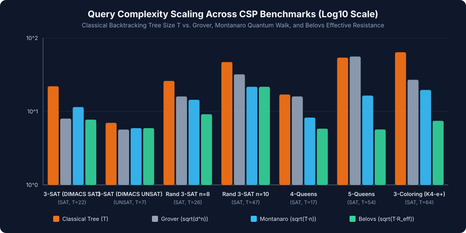
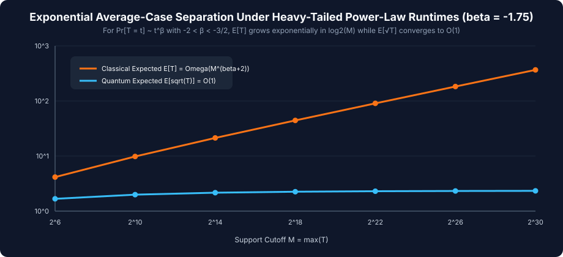

# Quantum Walk Speedup of Backtracking Algorithms

**Exact Statevector Simulation, Belovs' Electrical Network Analysis, Quantum Phase Estimation, and Heavy-Tailed Average-Case Complexity**

> A modular, zero-dependency Python implementation and complete theoretical study of Ashley Montanaro's discrete-time quantum walk speedup for classical backtracking algorithms ([Theory of Computing 14(15), 2018](https://theoryofcomputing.org/articles/v014a015/v014a015.pdf) / [arXiv:1509.02374](https://arxiv.org/abs/1509.02374)).

- **Language:** Python 3.9+ (Standard Library Only — Zero External Dependencies)
- **Full Technical Report:** [docs/report.pdf](docs/report.pdf) ([LaTeX Source](docs/report.tex))
- **Author:** Rajath Gadagkar ([rajathgadagkar@gmail.com](mailto:rajathgadagkar@gmail.com))
- **License:** [MIT License](LICENSE)

## Overview

Classical **backtracking** solves Constraint Satisfaction Problems (CSPs)—such as Boolean Satisfiability (**k-SAT / DPLL**), **$N$-Queens**, and **Graph $k$-Coloring**—by exploring an implicitly defined tree $\mathcal{T}$ of $T$ valid partial assignments and pruning dead branches early. While unstructured Grover search requires $O(\sqrt{d^n})$ queries, Montanaro proved that a coinless discrete-time quantum walk on $\mathcal{T}$ achieves an **instance-adaptive near-quadratic speedup** over *any* classical backtracking heuristic $h$, without knowing the tree structure or size $T$ in advance:

| Algorithm | Oracle Query Complexity | Key Property |
| :--- | :--- | :--- |
| **Classical Backtracking** (Algorithm 1) | $O(T)$ | Explores all $T$ valid partial assignments |
| **Grover's Search** | $O(\sqrt{d^n})$ | Ignores partial-assignment pruning |
| **Montanaro Detection** (Theorem 1 / Alg. 2) | $O(\sqrt{Tn}\log(1/\delta))$ | Known upper bound $T$; decides existence |
| **Montanaro General Search** (Theorem 2) | $O(\sqrt{T}\,n^{3/2}\log n \log(1/\delta))$ | Unknown $T$ (exponential doubling + subtree descent) |
| **Montanaro Unique-Solution Search** (Sec. 2.2) | $O(\sqrt{Tn}\log^3 n \log(1/\delta))$ | Promised unique marked vertex; samples $\|\tilde{\phi}'\rangle$ |
| **Belovs / Jarret–Wan** ([Phys. Rev. A 97, 2018](https://link.aps.org/doi/10.1103/PhysRevA.97.022337)) | $\tilde{O}(\sqrt{T \cdot R_{\mathrm{eff}}(r, M)})$ | Adapts to effective electrical resistance $R_{\mathrm{eff}} \le n$ |

This repository extends the initial extended abstract (`docs/extended_abstract.tex`) into a **complete theoretical and computational study**:

1. **Zero-Dependency $O(T)$-Step Quantum Walk Simulator** (`src/quantum_backtracking/quantum_walk.py`): Matrix-free application of Montanaro's local star diffusion operators $D_x$, bipartition reflections $R_A, R_B$, and walk unitary $W = R_B R_A$, plus exact unitarity and eigenvalue-1 eigenvector $|\phi'\rangle$ verification.
2. **Exact Quantum Phase Estimation & Search Suite** (`src/quantum_backtracking/phase_estimation.py`): Exact $s$-qubit QPE probability spectra, Algorithm 2 Chernoff detection, Theorem 2 subtree binary search with exponential doubling, and Section 2.2 unique-solution eigenvector sampling.
3. **Belovs' Electrical Network Engine** (`src/quantum_backtracking/electrical_networks.py`): Exact series–parallel effective resistance $R_{\mathrm{eff}}(r, M)$, minimum-energy unit electrical flows, and numerical verification of Kirchhoff's current law and Thomson's principle ($\mathcal{E}(f) = R_{\mathrm{eff}}$).
4. **Heavy-Tailed Average-Case & Statistical Physics Models** (`src/quantum_backtracking/average_case.py`): `NaïveBt` Proposition 8 exact and asymptotic bounds on random $k$-SAT, power-law runtime separation ($\Pr[T=t] \sim t^\beta$ for $-2 < \beta < -3/2$), and varying-density 3-SAT exponential separations.
5. **Publication-Grade Technical Report** (`docs/report.tex` & `docs/report.pdf`): Complete proofs, comparative quantum walk survey (Szegedy, Ambainis, Magniez, Childs), statistical physics context (Cocco–Monasson), and modern QSVT reformulations ([Gilyén et al., 2019](https://www.researchgate.net/publication/333915174_Quantum_singular_value_transformation_and_beyond_exponential_improvements_for_quantum_matrix_arithmetics); [Aoki & Kawachi, 2026](https://ken.ieice.org/ken/paper/20260528tcvX/eng/)).

## Repository Architecture

```text
quantum-walk-backtracking/
├── README.md                                  # Project overview, theory highlights, and empirical results
├── LICENSE                                    # MIT License (Copyright (c) 2026 Rajath Gadagkar)
├── docs/
│   ├── report.pdf                             # Compiled publication-grade full technical report
│   ├── report.tex                             # LaTeX source of the complete technical report
│   ├── extended_abstract.tex                  # Clean extended abstract (LaTeX source)
│   └── figures/                               # Reproducible SVG visualizations generated from benchmarks
│       ├── quantum_vs_classical_scaling.svg
│       ├── phase_estimation_spectrum.svg
│       └── power_law_runtime_separation.svg
├── src/
│   └── quantum_backtracking/
│       ├── __init__.py                        # Public package API
│       ├── csp.py                             # CSP abstractions, DIMACS CNF parser, k-SAT, N-Queens, Graph Coloring
│       ├── backtracking.py                    # Algorithm 1 tree builder, DPLL unit-clause & NaïveBt heuristics
│       ├── quantum_walk.py                    # O(T) diffusion operators D_x, R_A, R_B, W = R_B R_A & |phi'> verifier
│       ├── phase_estimation.py                # Exact s-qubit QPE, Algorithm 2 detection, Theorem 2 search algorithms
│       ├── electrical_networks.py             # Belovs' effective resistance R_eff(r, M) & Thomson unit-flow solver
│       └── average_case.py                    # Proposition 8 bounds, power-law tails, & varying-density 3-SAT
├── benchmarks/
│   ├── sample_3sat_sat.cnf                    # Standard DIMACS CNF benchmark (satisfiable)
│   ├── sample_3sat_unsat.cnf                  # Standard DIMACS CNF benchmark (unsatisfiable)
│   └── run_benchmarks.py                      # End-to-end benchmark runner and SVG plot generator
├── results/
│   └── benchmark_summary.json                 # Exact JSON metrics from the latest benchmark run
└── tests/
    ├── test_csp_and_backtracking.py           # Unit tests for DIMACS parsing, CSPs, and classical backtracking
    ├── test_quantum_walk.py                   # Unitarity, eigenvector invariance, QPE, and search correctness tests
    └── test_theory_and_average_case.py        # Thomson's principle, KCL, Proposition 8, and power-law tests
```

## Mathematical Highlights

### 1. Coinless Tree Quantum Walk ($W = R_B R_A$)
Partition the tree vertices into even-depth nodes $A$ (including root $r$) and odd-depth nodes $B$. Each vertex $x$ acts on its local star subspace $\mathcal{H}_x = \mathrm{span}(\{|x\rangle\} \cup \{|y\rangle : x \to y\})$ via a diffusion operator $D_x$:
- **Marked vertex ($P(x) = \text{true}$):** $D_x = I$ (breaks reflection symmetry).
- **Unmarked internal/leaf ($x \neq r$):** $D_x = I - 2|\psi_x\rangle\langle\psi_x|$ with $|\psi_x\rangle = \frac{1}{\sqrt{d_x}}(|x\rangle + \sum_{y: x \to y}|y\rangle)$.
- **Unmarked root ($x = r$):** $D_r = I - 2|\psi_r\rangle\langle\psi_r|$ with $|\psi_r\rangle = \frac{1}{\sqrt{1 + d_r n}}(|r\rangle + \sqrt{n}\sum_{y: r \to y}|y\rangle)$.

Whenever a marked vertex $x_0$ exists at depth $l(x_0) \le n$, the path vector
$$|\phi\rangle = \sqrt{n}\,|r\rangle + \sum_{x \neq r,\, x \sim x_0} (-1)^{l(x)} |x\rangle$$
is an **exact eigenvalue-1 eigenvector** of $W = R_B R_A$ with root overlap $|\langle r|\phi'\rangle|^2 = \frac{n}{n + l(x_0)} \ge \frac{1}{2}$. Conversely, when no solution exists, the Effective Spectral Gap Lemma bounds the low-phase support by $\|P_\chi |r\rangle\| \le \chi\sqrt{Tn}$, allowing QPE with precision $\beta/\sqrt{Tn}$ to cleanly separate SAT ($\ge 1/2$) from UNSAT ($\le 1/4$) using a $3/8$ Chernoff threshold.

### 2. Connection to Quantum Singular Value Transformation (QSVT)
Rather than relying on $s$-qubit QPE, recent QSVT formulations ([Gilyén et al., 2019](https://www.researchgate.net/publication/333915174_Quantum_singular_value_transformation_and_beyond_exponential_improvements_for_quantum_matrix_arithmetics); [Aoki & Kawachi, 2026](https://ken.ieice.org/ken/paper/20260528tcvX/eng/)) directly form the projected unitary $D_{\mathcal{T}} = \Pi_A \Pi_B$ from Montanaro's reflection projectors and replace phase estimation with a degree-$O(\sqrt{Tn})$ QSVT polynomial filter isolating singular value $1$—reducing ancilla overhead while clarifying fault-tolerant resource requirements.

## Empirical Results & Visualizations

### Query Complexity Scaling Across CSP Benchmarks



| Benchmark | Status | Tree Size ($T$) | $R_{\mathrm{eff}}(r, M)$ | Grover ($\sqrt{d^n}$) | Montanaro ($\sqrt{Tn}$) | Belovs ($\sqrt{T R_{\mathrm{eff}}}$) | QPE $\Pr[0^s]$ | Detected? |
| :--- | :---: | :---: | :---: | :---: | :---: | :---: | :---: | :---: |
| **3-SAT (DIMACS SAT)** | SAT | 22 | 2.7143 | 8.00 | 11.49 | **7.73** | 0.6885 | Yes |
| **3-SAT (DIMACS UNSAT)** | UNSAT | 7 | $\infty$ | 5.66 | 5.92 | 5.92 | **0.0121** | No |
| **Random 3-SAT ($n=8$)** | SAT | 26 | 3.2308 | 16.00 | 14.42 | **9.17** | 0.7129 | Yes |
| **Random 3-SAT ($n=10$)** | SAT | 47 | 10.0000 | 32.00 | 21.68 | **21.68** | 0.5018 | Yes |
| **4-Queens** | SAT | 17 | 2.0000 | 16.00 | 8.25 | **5.83** | 0.6669 | Yes |
| **5-Queens** | SAT | 54 | 0.6000 | 55.90 | 16.43 | **5.69** | 0.8929 | Yes |
| **3-Coloring (6-vertex)** | SAT | 64 | 0.8667 | 27.00 | 19.60 | **7.45** | 0.8738 | Yes |

### Exact QPE Phase Spectrum: SAT vs. UNSAT Separation


### Heavy-Tailed Power-Law Runtime Separation ($\beta = -1.75$)



## Quickstart

Zero third-party packages are required—only **Python 3.9+**.

### 1. Run the Test Suite
```bash
python3 -m unittest discover -s tests -v
```

### 2. Reproduce All Benchmarks & SVG Figures
```bash
PYTHONPATH=src python3 benchmarks/run_benchmarks.py
```

### 3. Use the Python API
```python
from quantum_backtracking import (
    KSATInstance,
    analyze_tree_electrical_network,
    build_backtracking_tree,
    detect_marked_vertex,
    find_marked_vertex_binary_search,
)

# Load a DIMACS CNF instance and build the DPLL (unit-clause) backtracking tree
csp = KSATInstance.from_dimacs_file("benchmarks/sample_3sat_sat.cnf", use_unit_clause=True)
tree = build_backtracking_tree(csp)

# Analyze Belovs' electrical network (effective resistance & Thomson unit flow)
elec = analyze_tree_electrical_network(tree, domain_size=2, num_vars=csp.num_vars)
print(f"T={tree.num_vertices}, R_eff={elec.effective_resistance:.4f}, sqrt(T*R_eff)={elec.belovs_resistance_scale:.2f}")

# Run Algorithm 2 (QPE Marked Vertex Detection) and Theorem 2 (Binary-Search Search)
det = detect_marked_vertex(tree, delta=0.05)
sol = find_marked_vertex_binary_search(tree, num_vars=csp.num_vars, known_t_bound=tree.num_vertices)
print(f"Detected={det.detected} (Pr[phase=0]={det.zero_phase_prob:.4f}), Assignment={sol.assignment_str}")
```

## Key References

- **A. Montanaro**, *Quantum-Walk Speedup of Backtracking Algorithms*, [Theory of Computing 14(15):1–24 (2018)](https://theoryofcomputing.org/articles/v014a015/v014a015.pdf) / [arXiv:1509.02374](https://arxiv.org/abs/1509.02374).
- **A. Belovs**, *Quantum Walks and Electric Networks*, [arXiv:1302.3143 (2013)](https://arxiv.org/abs/1302.3143).
- **M. Jarret & K. Wan**, *Improved Quantum Backtracking Algorithms Using Effective Resistance Estimates*, [Phys. Rev. A 97, 022337 (2018)](https://link.aps.org/doi/10.1103/PhysRevA.97.022337) / [arXiv:1711.05295](https://arxiv.org/pdf/1711.05295).
- **A. Ambainis & M. Kokainis**, *Quantum Algorithm for Tree Size Estimation, with Applications to Backtracking and 2-Player Games*, STOC 2017.
- **A. Gilyén, Y. Su, G. H. Low, & N. Wiebe**, *Quantum Singular Value Transformation and Beyond*, [STOC 2019](https://www.researchgate.net/publication/333915174_Quantum_singular_value_transformation_and_beyond_exponential_improvements_for_quantum_matrix_arithmetics).
- **D. Aoki & A. Kawachi**, *Lattice Enumeration via Quantum Singular Value Transformation*, [IEICE Technical Report (2026)](https://ken.ieice.org/ken/paper/20260528tcvX/eng/).
- **S. Cocco & R. Monasson**, *Statistical Physics Analysis of the Computational Complexity of Solving Random Satisfiability Problems Using Backtrack Algorithms*, Eur. Phys. J. B 22:505–531 (2001).

## Author & License

- **Author:** Rajath Gadagkar ([rajathgadagkar@gmail.com](mailto:rajathgadagkar@gmail.com))
- **License:** Distributed under the [MIT License](LICENSE).
